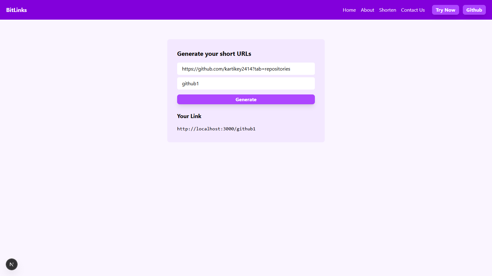

# Project Name

A fast, minimalist URL shortener.

<p align="center">
  
  &nbsp;
  
</p>

## Features

- Instant link shortening
- Custom aliases
- Click tracking

## Tech Stack

Node.js · Express · MongoDB · Tailwind CSS

## Setup

```bash
git clone [https://github.com/yourusername/your-repo.git](https://github.com/yourusername/your-repo.git)
cd your-repo
npm install